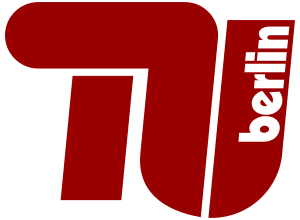

### Hi, I'm Amor 👋

AI enthusiast · CS student @ TU Berlin · working at Porsche

  <picture>
    <source media="(prefers-color-scheme: dark)" srcset="assets/tu-berlin-dark.svg">
    
  </picture>
  &nbsp;&nbsp;&nbsp;&nbsp;
  <picture>
    <source media="(prefers-color-scheme: dark)" srcset="assets/porsche-dark.svg">
    
  </picture>

**What I'm into**

- 🤖 AI agents that plan, use tools and get real tasks done
- 🔌 Model Context Protocol (MCP) and connecting LLMs to real systems
- 🧠 How LLMs work under the hood
- 🛠️ Agentic workflows for everyday automation
- 🚀 Trying new AI tools the week they come out

   
